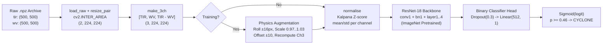

# CycloneNet Architecture & Training Pipeline

This document specifies the end-to-end tensor transformations, neural network architecture, residual skip connections, transfer learning mechanics, and training/inference flow implemented in `CycloneNet_Submission`.

---

## 1. End-to-End Pipeline Diagram



---

## 2. Input Representation (`common.py` & `dataset.py`)

### 2.1 Why `[TIR, WV, TIR - WV]`?
Pretrained ImageNet ResNets expect a 3-channel `(3, 224, 224)` input tensor. Rather than duplicating grayscale bands or modifying `conv1` (which would discard pretrained weights or require surgery), `make_3ch()` constructs:
- **Channel 0 (`TIR`):** Thermal Infrared counts — encodes cloud-top coldness/height.
- **Channel 1 (`WV`):** Water Vapour counts — encodes upper-level moisture and outflow plumes.
- **Channel 2 (`TIR - WV`):** Difference band — highlights deep convective towers where cloud tops approach the tropopause, directly emphasizing cyclone core structure.

### 2.2 Shape & Data Type Progression
1. `load_raw(path)` → `tir (500, 500)`, `wv (500, 500)` (`float32`, NaNs zeroed)
2. `resize_pair(tir, wv, 224)` → `(2, 224, 224)` via `cv2.INTER_AREA`
   - Offline cache (`prepare_data.py`): saved as `float16` in `cache/X.npy` (`(1959, 2, 224, 224)`), exact for Kalpana integer counts `<= 1023`.
3. `make_3ch(x2)` → `(3, 224, 224)` (`float32`)
4. `CycloneSet._augment(x)` *(training only)*:
   - `np.roll(x, (dy, dx), axis=(1, 2))` with `dx, dy ∈ [-16, 16]`
   - `x[:2] *= U(0.97, 1.03)` and `x[:2] += U(-10, 10)`
   - `x[2] = x[0] - x[1]`
   - **Invariant:** Chirality (counter-clockwise spin) is never inverted.
5. `normalise(x3, norm)` → `(3, 224, 224)` Z-score normalized using `cache/norm.json`.

---

## 3. ResNet-18 Neural Network Architecture (`model.py`)

### 3.1 Backbone & Residual Skip Connections
`outputs/final.pt` stores a `torchvision.models.resnet18` network (`11,177,025` parameters). Each `BasicBlock` computes:

$$\mathbf{y} = \mathcal{F}(\mathbf{x}, \{W_i\}) + \mathbf{x}$$

where $\mathcal{F}(\mathbf{x})$ consists of two `3×3` convolutions with BatchNorm and ReLU, and the identity (or `1×1` projection stride-2 downsample) shortcut $+\mathbf{x}$ allows gradients from the binary cyclone loss to propagate cleanly back to earlier spatial stages without vanishing, preserving both fine cloud-band texture and global spiral morphology.

*(Note: `model.py` maintains a registry `_ARCH` supporting `"resnet18"`, `"resnet34"`, and `"resnet50"`. The shipped checkpoint `outputs/final.pt` uses `"resnet18"`.)*

### 3.2 Layer-by-Layer Parameter & Freezing Breakdown

| Module | Output Spatial Size | Parameters | Stage 1 (`head`) | Stage 2 (`finetune`) | Purpose |
|---|---|---:|---|---|---|
| `conv1` + `bn1` + `maxpool` | `56 × 56 × 64` | 9,536 | Frozen (`eval()`) | Frozen (`eval()`) | Low-level oriented edges & gradients |
| `layer1` (2 BasicBlocks) | `56 × 56 × 64` | 147,968 | Frozen (`eval()`) | Frozen (`eval()`) | Generic local textures |
| `layer2` (2 BasicBlocks) | `28 × 28 × 128` | 525,568 | Frozen (`eval()`) | Frozen (`eval()`) | Mid-level cloud fragments |
| `layer3` (2 BasicBlocks) | `14 × 14 × 256` | 2,099,712 | Frozen (`eval()`) | **Trainable** (`0.3 × lr_ft`) | Regional convective bands & curvature |
| `layer4` (2 BasicBlocks) | `7 × 7 × 512` | 8,393,728 | Frozen (`eval()`) | **Trainable** (`1.0 × lr_ft`) | Full synoptic vortex / eye structure |
| `avgpool` | `1 × 1 × 512` | 0 | Stateless | Stateless | Global spatial pooling |
| `fc` (`Dropout(0.3) → Linear(512, 1)`) | `1` logit | 513 | **Trainable** (`lr_head`) | **Trainable** (`3.0 × lr_ft`) | Binary cyclone logit |
| **Total** | — | **11,177,025** | **513 trainable** | **10,493,953 trainable** | |

### 3.3 Why Freeze BatchNorm in `eval()` Mode? (`set_train_mode`)
In PyTorch, setting `requires_grad = False` freezes weights/biases, **not** `BatchNorm2d` running mean/variance updates during forward passes. `model.set_train_mode(model, stage)` explicitly calls `.eval()` on all frozen blocks (`conv1..layer4` in Stage 1; `conv1..layer2` in Stage 2) so batch-level fluctuations on small meteorological minibatches (`batch = 32`) never corrupt ImageNet feature normalization.

---

## 4. Two-Stage Training & Optimization (`train.py`)

```text
Stage 1 ("head")     [5 epochs]  : AdamW(lr=1e-3, wd=1e-4) -> CosineAnnealingLR(T_max=5)
                                   Trains fc only; stabilizes randomly initialized classifier weights.
                                         │
                                         ▼
Stage 2 ("finetune") [15 epochs] : AdamW(wd=1e-4) -> CosineAnnealingLR(T_max=15)
                                   Discriminative LRs: layer3=3e-5, layer4=1e-4, fc=3e-4.
```

- **Imbalance Compensation:** `BCEWithLogitsLoss(pos_weight = N_neg / N_pos)` (`4.550` for full Kalpana training).
- **Threshold Calibration:** Concatenates out-of-fold probabilities across the 5 held-out validation years (`2009`–`2013`), evaluates `np.linspace(0.1, 0.9, 81)`, and stores the F1-maximizing threshold (`0.46`) inside `outputs/final.pt`.

---

## 5. Checkpoint Structure & Inference Pipeline

`outputs/final.pt` is a Python `dict` saved via `torch.save` with four keys:
- `state`: `OrderedDict` (`122` state-dict tensors for ResNet-18 + `fc`)
- `arch`: `"resnet18"`
- `norm`: `{"mean": [...], "std": [...]}`
- `threshold`: `0.45999999999999996` (`0.46`)

Both `test_insat.py` and `predict.py` / `predict_gui.py` reconstruct the model from `ck["arch"]` with `pretrained=False`, load `ck["state"]`, normalize new INSAT/Kalpana frames using `ck["norm"]`, compute `prob = torch.sigmoid(model(x)).item()`, and classify `CYCLONE` when `prob >= ck["threshold"]`.
